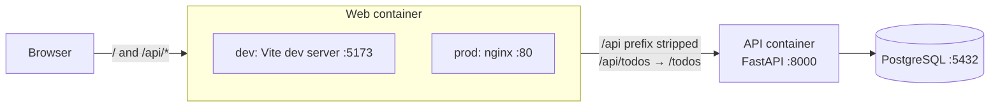

# Architecture

This document explains how the pieces fit together and why they are built this way.
For running the project, see the [README](../README.md).

## Overview



The browser only ever talks to the **web container**. It serves the SPA and forwards every
request under `/api` to the API:

| Mode | Who serves the SPA | Who forwards `/api` | Config |
|---|---|---|---|
| Development | Vite dev server (hot reload) | Vite `server.proxy` | `web/vite.config.ts` |
| Production-like | nginx (static files from `vite build`) | nginx `proxy_pass` | `web/nginx.conf` |

In both modes the `/api` prefix is removed before the request reaches FastAPI, so the API
itself has no prefix: `GET /api/todos` in the browser becomes `GET /todos` in the API.

### Why a proxy instead of CORS

Because the SPA and the API are served from the **same origin** (the web container), the
browser never makes a cross-origin request. The API therefore needs no CORS configuration,
and the frontend code is the same in every environment: it always calls `/api/...`
(see `web/src/lib/api.ts`). Only the proxy target changes (`API_URL` in dev, the `api`
service name in `nginx.conf`).

## API

### Layers

```
app/config.py   Settings from env vars / .env (pydantic-settings)
      ↓
app/db.py       Engine, session factory, transaction boundary, soft-delete filter, Base
      ↓
app/models/     SQLAlchemy table models (+ mixins)      app/schemas/   Pydantic request/response models
      ↓                                                       ↓
app/routers/    HTTP endpoints: validate with schemas, read/write models
      ↓
app/main.py     FastAPI app, lifespan (creates tables), router registration
```

- **Models** (`app/models/`) describe database tables. They inherit from `Base` in `app/db.py`
  and from the mixins in `app/models/mixins.py`.
- **Schemas** (`app/schemas/`) describe what the API accepts and returns. They are separate
  from the models, so the database shape and the API shape can change independently.
  `TodoResponse` uses `from_attributes=True`, so it can be built directly from a model instance.
- **Constants** (`app/constants/`) hold fixed values such as `TodoStatus.OPEN`.

### One transaction per request

`app/db.py` defines the transaction boundary:

- `session_scope()` opens a session, **commits** when the block succeeds, **rolls back** when
  an exception escapes, and always closes the session.
- `get_db()` wraps `session_scope()` as a FastAPI dependency, and `DbSession` is the
  annotated type that routes use. `scope="function"` makes the commit happen before the
  response is sent, so a failed commit becomes a 500 instead of a silently lost write.

As a result, **routes never call `commit()`**. They call `session.flush()` when they need the
database to apply a change early, for example to read back server-generated values with
`session.refresh()`. This matches the linden-api rule that repositories and commands never
end the transaction.

### Soft delete

Models that include `SoftDeleteMixin` get a nullable `deleted_at` column. Deleting a todo sets
`deleted_at` instead of issuing a SQL `DELETE`.

A `do_orm_execute` event listener in `app/db.py` adds `WHERE deleted_at IS NULL` to every ORM
`SELECT` for those models, so soft-deleted rows disappear from all queries automatically. To
include them (for example in an admin view or a test), opt out per query:

```python
select(Todo).execution_options(skip_soft_delete_filter=True)
```

**Use `select()`, not `session.get()`, to load by id.** `session.get()` returns an object
straight from the session's identity map when it is already loaded, without running a query,
so the soft-delete filter never applies. This is why `app/routers/todos.py` loads todos with
`get_todo_or_404()`, which runs a `select()`. linden-api uses the same approach in its
repositories.

### Timestamps and ids

- `TimestampMixin` adds `created_at` and `updated_at` (set in UTC by SQLAlchemy, updated on
  every change).
- Primary keys are UUIDs generated by the API (`uuid4`), not database sequences.

### Database schema management

On startup, `create_db_and_tables()` (in `app/db.py`, called from the lifespan in `app/main.py`)
runs `Base.metadata.create_all()`. It creates missing tables but **never alters existing ones**:
if you add or rename a column, drop the table, or add Alembic migrations, which is the planned
replacement.

## Web app

- **SPA mode.** `web/src/routes/+layout.ts` sets `ssr = false`, so every page renders in the
  browser. `@sveltejs/adapter-static` builds plain files into `web/build/`, with `200.html` as
  the fallback entry point for any URL that is not a real file.
- **Client-side routing in production.** nginx serves real files when they exist and falls back
  to `200.html` otherwise (`try_files $uri /200.html`), so deep links and page reloads work.
- **Caching.** Hashed assets under `/_app/immutable/` are cached for a year; `200.html` is
  served with `Cache-Control: no-cache`, so a new deploy is picked up on the next load.
- **API client.** `web/src/lib/api.ts` holds the TypeScript types (mirroring the API schemas)
  and one function per endpoint. Pages import from it instead of calling `fetch` directly.

## Monorepo layout

`api/` and `web/` are independent projects with their own dependencies, lockfiles and
Dockerfiles. They only share the Compose files and `.env` at the repository root. The web app
folder is called `web/` rather than `app/` to avoid confusion with the Python package `api/app/`.
